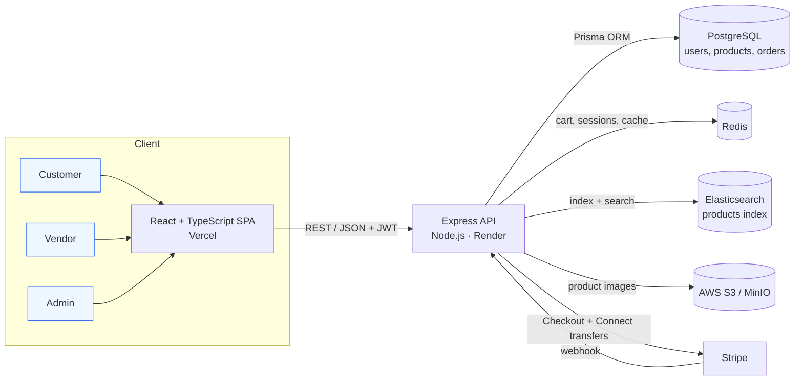
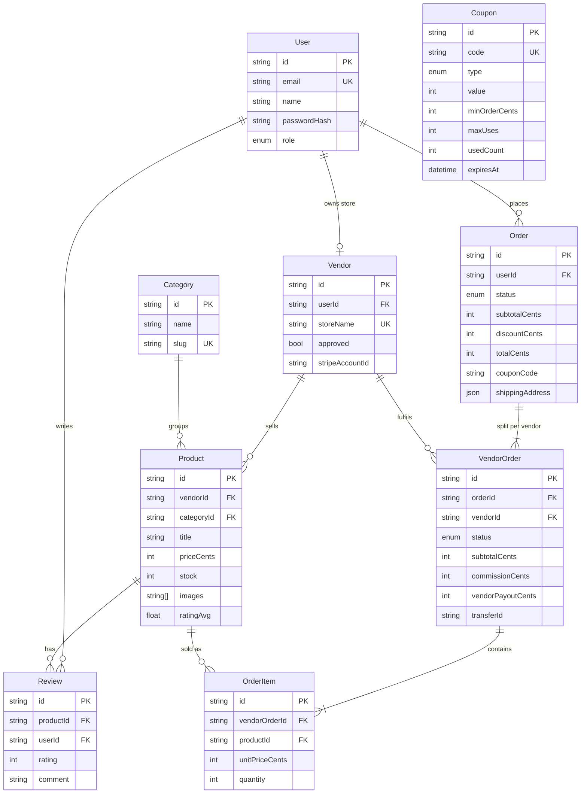
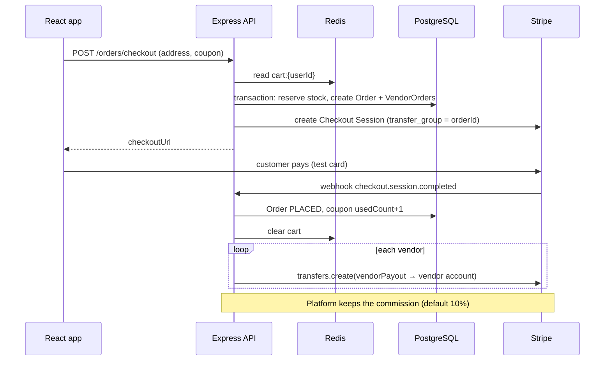
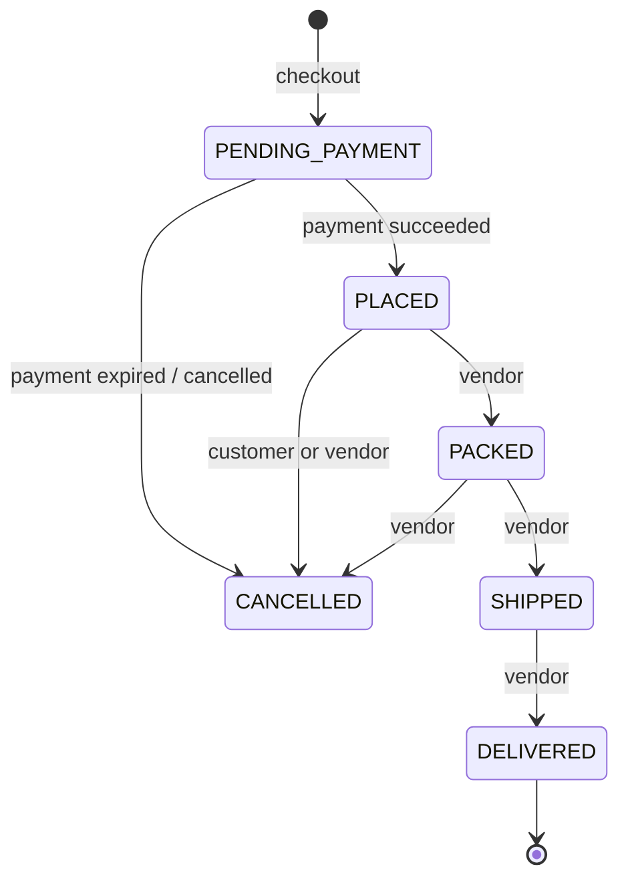

# FS-01 Architecture

## System overview

## Roles

| Role | Can do |
|---|---|
| Customer | Search, view products, cart, checkout, pay, track orders, cancel, download invoices, review delivered products |
| Vendor | Store profile, Stripe payout onboarding, product CRUD + images, fulfil orders (pack/ship/deliver), see earnings |
| Admin | Analytics, approve/suspend vendors, manage coupons and categories, view all orders |

## Database schema

**Design decisions**

- **Money as integers (cents).** Avoids floating-point rounding errors in totals and commission.
- **Order → VendorOrder split.** A single customer order can contain products from several vendors. Each vendor packs and ships separately and is paid separately, so each vendor gets its own sub-order with its own status, commission and payout.
- **Price snapshot in OrderItem.** Title and unit price are copied at purchase time so later product edits don't change past orders or invoices.
- **PostgreSQL is the source of truth; Elasticsearch is a search copy.** Every product change calls `indexProduct()`; `npm run reindex` rebuilds the index from scratch.

## Checkout & split payment flow

## Order lifecycle

## Redis usage

| Key | Type | Purpose | TTL |
|---|---|---|---|
| `session:{sid}` | string (JSON) | Logged-in session, allows logout/revocation | 7 days |
| `cart:{userId}` | hash productId → qty | Shopping cart | 30 days |
| `product:{id}` | string (JSON) | Product detail cache | 60 s |
| `categories` | string (JSON) | Category list cache | 5 min |

## Security

- Passwords hashed with bcrypt; JWT signed with `JWT_SECRET`; sessions revocable in Redis.
- Role checks on every protected route; vendors can only touch their own products and orders.
- All input validated with Zod; uploads limited to images ≤ 5 MB.
- Helmet security headers, CORS restricted to `CLIENT_URL`, rate limit on `/api/auth`.
- Stripe webhooks verified by signature. Secrets only in `.env` (never committed).
