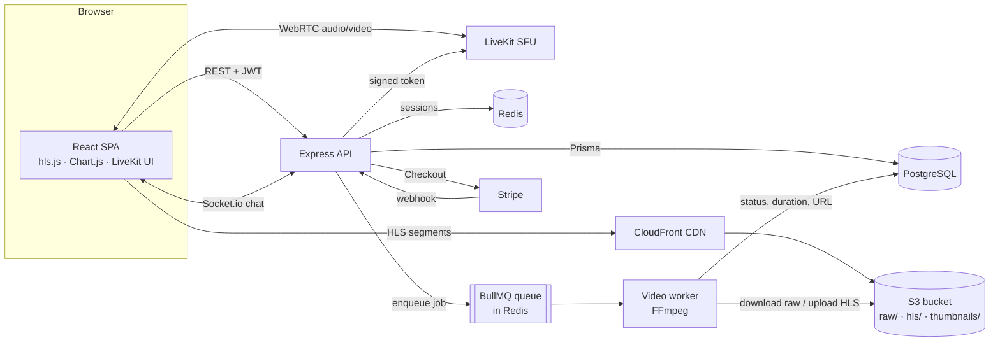
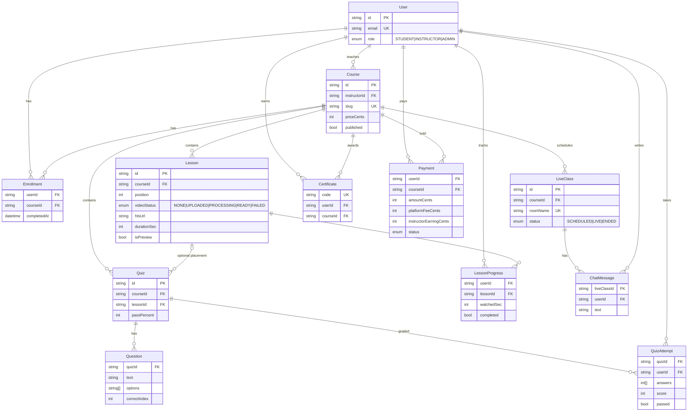
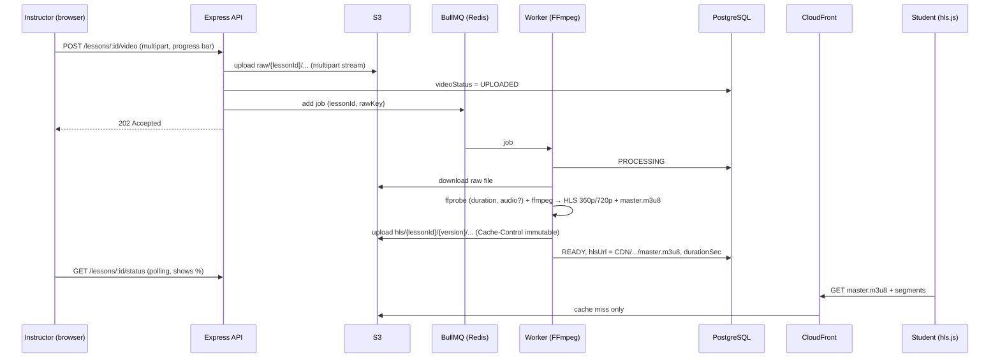
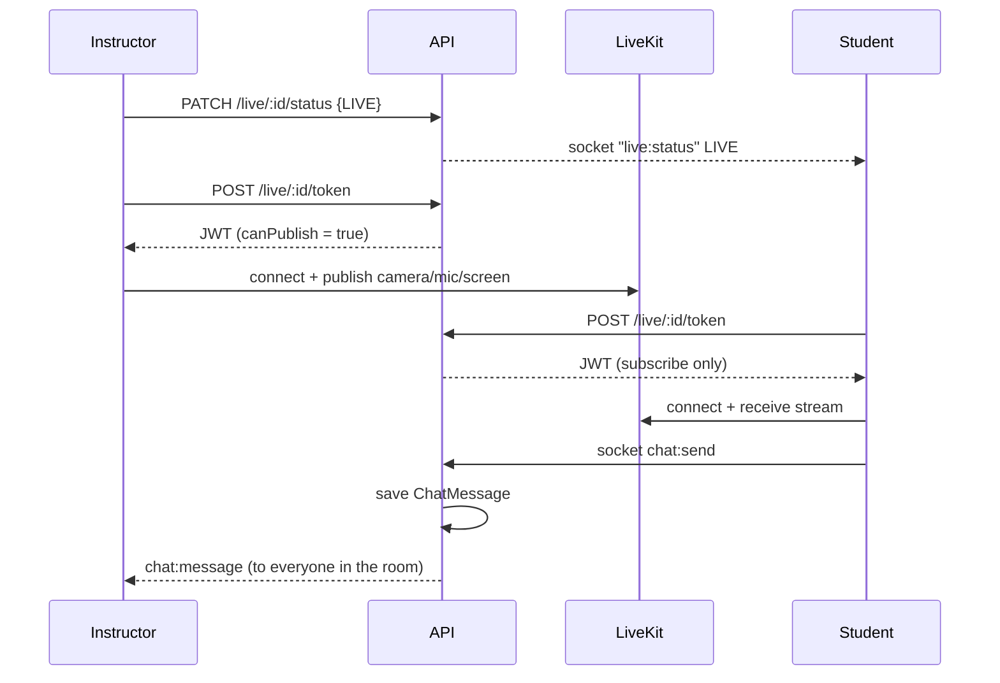

# FS-03 Architecture

## System overview



The API never processes video itself: uploads are handed to a **separate worker process** through a **BullMQ** queue, so a long FFmpeg job can't slow down normal requests, and you can scale workers independently.

## Database schema



## Video pipeline (upload → FFmpeg → CloudFront)



**FFmpeg output** (tested on sample videos with and without audio):

```
hls/{lessonId}/{version}/master.m3u8
hls/{lessonId}/{version}/v360p/index.m3u8, seg_000.ts, seg_001.ts …
hls/{lessonId}/{version}/v720p/index.m3u8, seg_000.ts, …
```

The player starts at the quality the bandwidth allows and switches automatically (adaptive bitrate).

## Live class



## Completion & certificate rules

- A lesson is **completed** when the student watched ≥ 90% of it, or clicked "Mark as complete".
- A course is **complete** when every lesson is completed **and** every quiz has at least one passing attempt.
- On completion `Enrollment.completedAt` is set; the certificate is created once (unique per user + course) with a random public code.

## Payments

`revenueSplit(price, PLATFORM_FEE_PERCENT)` → platform fee + instructor earning, stored on each `Payment`. Stripe Checkout (test mode) handles the card; the `checkout.session.completed` webhook marks the payment PAID and creates the enrollment (idempotent). Instructor payouts are reported on the dashboard. Stripe Connect transfers (as in FS-01) can be added for automatic payouts.

## Security

- bcrypt passwords, JWT + Redis sessions (revocable), role checks on every route, ownership checks (`assertCourseOwner`, `assertCourseAccess`).
- Lesson video URLs and notes are only returned to enrolled students, the instructor, or for preview lessons.
- Quiz answers are graded server-side; `correctIndex` is never sent to students before submission.
- LiveKit tokens are short-lived and scoped to one room; only the host can publish.
- Socket.io connections require a valid JWT and course access to join a room.
- Zod validation everywhere, upload type/size limits, Helmet, CORS, rate limiting on auth, Stripe webhook signature check.
